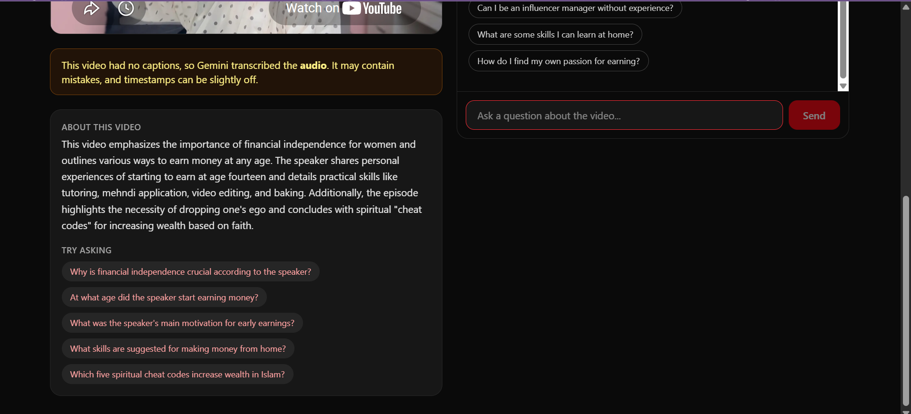

# 🎥 YouTube RAG Chatbot

Ask any question about a YouTube video's transcript and get answers with **clickable timestamps**.



**Flow:** YouTube URL → Transcript → Chunks (with timestamps) → Embeddings → FAISS → Top-k retrieval → Gemini → Answer + sources

## Tech stack
| Part | Tools |
|---|---|
| Frontend | React, Vite, Tailwind CSS |
| Backend | FastAPI, LangChain |
| RAG | youtube-transcript-api, sentence-transformers (all-MiniLM-L6-v2), FAISS |
| LLM | Google Gemini (multi-model fallback) |
| Deploy | Hugging Face Spaces (Docker) + Vercel |

## Folder structure
```
youtube-rag/
├── backend/    # FastAPI + RAG logic (rag.py, main.py, Dockerfile)
├── frontend/   # React UI
└── README.md
```

## Local setup

### 1. Backend
```bash
cd backend
python -m venv venv
venv\Scripts\activate            # Windows  (Mac/Linux: source venv/bin/activate)
pip install -r requirements.txt
copy .env.example .env           # Mac/Linux: cp .env.example .env  -> then add GEMINI_API_KEY to .env
uvicorn main:app --reload
```
API docs: http://localhost:8000/docs

### 2. Frontend
```bash
cd frontend
npm install
npm run dev
```
App: http://localhost:5173

## API
- `POST /load` — body `{ "url": "<youtube url>" }` → processes the transcript
- `POST /chat` — body `{ "video_id": "...", "question": "..." }` → `{ answer, sources: [{time, seconds}] }`

## Features
- Timestamped, clickable sources (the video plays from that point)
- Per-video caching
- Gemini multi-model fallback (switches to the next model on busy/503 errors)

## Future work
- Urdu/Hinglish videos (multilingual embeddings, Whisper fallback)
- Chat memory, retrieval evaluation, Chrome extension
